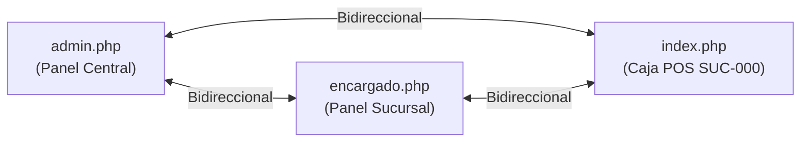

# Plan Consolidado — Admin con Acceso a 3 Vistas (Caja, Encargado, Admin) y Siguiente Etapa

**Estado:** ✅ **Completado, Auditado y Fusionado en `main`** (Commits `7de12d4` y `99c2fa7`).  
**Referencia:** Hoja de ruta [ROADMAP.md](ROADMAP.md) y arquitectura [ARQUITECTURA.md](ARQUITECTURA.md).

---

## 1. Contexto y Diagnóstico Original

Originalmente, el usuario `admin` tenía `sucursal_id = NULL` en base de datos (`database/init_usuarios.php`). Esto ocasionaba:

- En `index.php`: Se redirigía al admin a `admin.php` por no tener sucursal, bloqueando su acceso a la caja.
- En `admin.php`: Se ocultaba el enlace "Ir a caja" si la sesión no traía sucursal.
- En `ajax/registrar_venta.php` y `ajax/productos.php`: Se utilizaba el fallback `?? 1`, vendiendo en Patuju Central silenciosamente si no había sucursal.
- En `encargado.php`: El admin ingresaba con `sucursalId = 0` y no disponía de navegación de retorno a `admin.php`.

**Decisión estratégica adoptada:**  
Crear la sucursal interna `SUC-000 Administración` (`es_interna = 1`) para el rol `admin`. El control de permisos opera sobre la columna `usuarios.rol`.  
La sucursal interna funciona como entorno operativo aislado para pruebas y gestión del admin, sin aparecer en la landing pública ni alterar las métricas reales del negocio.

---

## 2. Implementación Realizada y Consolidada

### A. Base de Datos e Inicialización
1. **Migración Idempotente (`actualizar_bd.php`):**
   - Agrega la columna `es_interna TINYINT(1) NOT NULL DEFAULT 0 AFTER activo` en la tabla `sucursales` si no existe.
   - Inserta la sucursal `SUC-000` (`Administración`, `Oficina central`, `es_interna = 1`, `activo = 1`) obteniendo su ID dinámicamente (`lastInsertId()` o consulta previa).
   - Siembra stock inicial mediante `INSERT IGNORE INTO stock_sucursal` (50 unidades, alerta 10) para todos los productos activos.
   - Asigna dicha sucursal interna a los usuarios con rol `admin`.
2. **Esquema Inicial (`database/schema.sql`):**
   - Definición de `sucursales` actualizada con la columna `es_interna`.
   - Registro semilla con ID 16 para `SUC-000`. El inventario inicial se genera automáticamente mediante el `CROSS JOIN` existente.
3. **Inicialización de Usuarios (`database/init_usuarios.php`):**
   - Búsqueda dinámica del ID de `SUC-000` (con fallback al ID 16) para asignar la sucursal al usuario `admin`, evitando discrepancias en bases migradas.

### B. Control de Sesión y Navegación
4. **Auto-recuperación de Sesión (`config/auth.php` - Commit `99c2fa7`):**
   - Incorporación de `asegurarSucursalAdmin()`: si el admin inició sesión previamente a la migración o carece de `sucursal_id`, consulta la BD y puebla la sesión en tiempo de ejecución.
5. **Caja POS (`index.php`):**
   - Invoca `asegurarSucursalAdmin()`.
   - Si la base de datos no está migrada y el usuario es admin, devuelve HTTP 503 con aviso claro ("No existe la sucursal interna de administración. Ejecuta actualizar_bd.php...") y botón de retorno a Admin.
   - Si un usuario no admin carece de sucursal, redirige a `logout.php?error=sin_sucursal`, eliminando bucles infinitos de redirección (`ERR_TOO_MANY_REDIRECTS`).
6. **Panel de Encargado (`encargado.php`):**
   - Invoca `asegurarSucursalAdmin()` al cargar la vista.
   - Conserva el botón "Ir a Caja POS" para cualquier usuario con sucursal (`$sucursalId > 0`).
   - Muestra el botón "Volver a Admin" exclusivamente si `$rol === 'admin'`.
   - Estandarización de modales: eliminados estilos `style="display: none;"` de los 4 modales (`#modal-lote`, `#modal-ajuste`, `#modal-movimientos`, `#modal-stock-diario`), pasando a control vía clase `.modal-overlay.active`.
7. **Frontend Encargado (`assets/js/encargado.js` - Commit `99c2fa7`):**
   - Apertura y cierre de modales adaptados a `classList.add('active')` y `classList.remove('active')`.
8. **Panel Admin (`admin.php`):**
   - Botón "Ir a caja" siempre disponible sin condiciones de sesión restrictivas.

### C. Blindaje y Aislamiento de Datos
9. **Endpoints AJAX (`ajax/registrar_venta.php` y `ajax/productos.php`):**
   - Retiro definitivo del fallback silencioso `?? 1`.
   - Validación estricta: si `empty($_SESSION['sucursal_id'])`, responde inmediatamente HTTP 403 (`['success' => false, 'error' => 'Sin sucursal asociada']`).
10. **Landing Pública (`landing.php`):**
    - Consulta pública filtrada con `WHERE activo = 1 AND es_interna = 0`.
11. **Analítica Gerencial (`ajax/analytics.php`):**
    - Exclusión total de la sucursal interna en las 11 consultas del dashboard y exportaciones CSV mediante `AND s.es_interna = 0` y `sucursal_id NOT IN (SELECT id FROM sucursales WHERE es_interna = 1)`. Ninguna venta de prueba del admin contamina métricas ni totales.

---

## 3. Matriz de Acceso y Navegación Resultante

| Rol | Caja (`index.php`) | Encargado (`encargado.php`) | Admin (`admin.php`) |
| :--- | :--- | :--- | :--- |
| **`admin`** | Acceso completo (opera en `SUC-000`). Enlaces a Sucursal y Admin. | Acceso completo. Enlaces a Caja POS y Volver a Admin. | Acceso completo. Enlaces a Ir a caja y Panel de sucursal. |
| **`encargado`** | Acceso a caja de su sucursal. Enlace a Sucursal. | Acceso a su sucursal principal y a las asignadas (Fase 2.5). Enlace a Caja POS. | Bloqueado (302 a `login.php?error=sin_permisos`). |
| **`caja`** | Acceso exclusivo a su caja. | Bloqueado (302 a `login.php?error=sin_permisos`). | Bloqueado (302 a `login.php?error=sin_permisos`). |

> Las vistas (`index.php`, `encargado.php`, `admin.php`) no responden 403: `verificarSesion()` redirige con 302 a `login.php?error=sin_permisos`. Los endpoints AJAX sí responden 403 (`{success:false, error:'Sin permisos'}`) vía `verificarSesionAjax()`. Además, la sesión se revalida contra la BD en cada petición: un usuario eliminado o desactivado es expulsado (vistas → `login.php`, AJAX → 401 `Sesión expirada`).

---

## 4. Nuevo Planteamiento: Próximas Etapas

Habiendo concluido el acceso y aislamiento de las 3 vistas, el proyecto se encuentra preparado para las fases subsiguientes (la Opción B ya quedó implementada; la Opción A sigue pendiente):

### Opción A — Fase 4: Resiliencia Offline y PWA (Prioridad de Negocio)
*Objetivo:* Garantizar la continuidad de venta en sucursales ante caídas de internet local.
- **Service Worker & App Manifest:** Configuración de `sw.js` y `manifest.json` para instalación PWA en equipos de caja.
- **Caché de Aplicación:** Estrategia *Network-first / Cache-fallback* para catálogos y assets esenciales.
- **Cola de Ventas en IndexedDB:** Registro local de transacciones offline y posterior sincronización atómica con el backend al recuperar conectividad.

### Opción B — Fase 2.5: Sistema de Usuarios y Permisos Granulares — ✅ Implementada
*Objetivo:* Reemplazar la asignación fija por roles por un módulo administrativo.
- ✅ Se optó por la función centralizada `puede($accion, ...$args)` en `config/auth.php` (sin tablas `permisos` / `rol_permisos`), junto con `obtenerSucursalesAsignadas()` y la tabla N:M `usuario_sucursales` para encargados multi-sucursal.
- ✅ Pantalla administrativa "Gestión de usuarios" en `admin.php` + `assets/js/admin.js`, respaldada por `ajax/usuarios.php` (alta, edición, cambio de sucursal y rol, asignación de sucursales, reseteo de claves y activación).
- Detalle técnico completo en [1user.md](1user.md).

---

## 5. Criterios de Aceptación Verificados
- [x] Migración `actualizar_bd.php` idempotente probada.
- [x] Admin asociado a `SUC-000` con stock sembrado.
- [x] Navegación fluida bidireccional entre las 3 vistas.
- [x] Sin bucles de redirección en sesiones sin sucursal.
- [x] Landing y analítica completamente libres de datos de `SUC-000`.
- [x] Modales de `encargado.php` homogéneos con clases CSS `.active`.
- [x] Re-verificado el 2026-11-04 (Terminal 2): modales con `.active` y `asegurarSucursalAdmin()` pasan `php -l` y `node --check`. Prueba en navegador pendiente por MySQL apagado.
