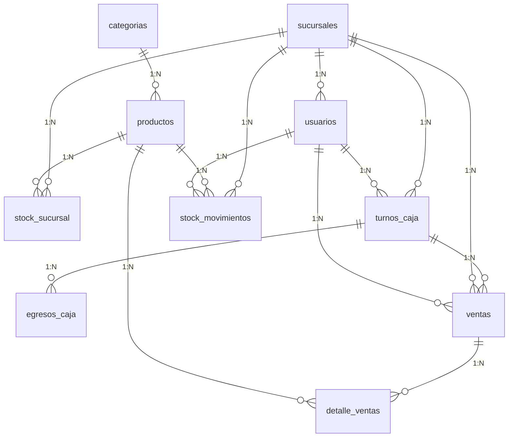

# BAKHEN — Análisis de Base de Datos Patuju POS

**Fecha:** 2026-10-04  
**BD:** `patuju_pos` · MySQL/InnoDB · utf8mb4  
**Estrategia de datos:** INSERTs directos en `database/schema.sql` (no seed PHP)

---

## 🔴 Problema #1: Hash de Contraseñas ROTO

El hash usado en todos los INSERTs de usuarios:

```
$2y$10$k2QdRrKJhz6nBqEX5YvFXOdG3HgJ8sL0mN2pQ4rS6tU8vW0xY2zA
```

**Este hash fue fabricado a mano, NO fue generado por `password_hash()`.** Por eso `password_verify('patuju2024', $hash)` retorna `false`.

Un hash bcrypt válido tiene exactamente **60 caracteres** y es generado por PHP. Si el hash tiene 59, le falta un carácter del salt y es inválido.

### Cómo está sobreviviendo el login

En `login.php` línea 76-81 hay un **fallback de texto plano**:

```php
} elseif ($user['password_hash'] === $password) {
    // Acepta texto plano y auto-hashea a bcrypt
    $loginOk = true;
    $newHash = password_hash($password, PASSWORD_BCRYPT);
    $db->prepare("UPDATE usuarios SET password_hash = ? WHERE id = ?")->execute([$newHash, $user['id']]);
}
```

Esto significa que si alguien puso la contraseña en texto plano en la BD, funciona una vez y se auto-corrige. **Pero con el hash fabricado, ni bcrypt ni texto plano coinciden → login falla.**

### Solución

Generar un hash **real** desde PHP (necesitas Laragon/XAMPP corriendo):

```php
php -r "echo password_hash('patuju2024', PASSWORD_BCRYPT) . PHP_EOL;"
```

Luego reemplazar TODAS las ocurrencias del hash viejo en `database/schema.sql`.

**O la vía rápida (beta):** Poner la contraseña en texto plano en los INSERTs. El fallback de `login.php` la aceptará y auto-hasheará a bcrypt en el primer login:

```sql
-- En schema.sql, cambiar TODOS los hashes por:
INSERT INTO usuarios (username, password_hash, ...) VALUES
('admin', 'patuju2024', ...),
...
```

> [!WARNING]
> La vía texto plano es solo para beta/desarrollo. Para producción, los INSERTs deben usar hashes bcrypt reales.

---

## Estado: 2 Schemas, 1 Problema

| Archivo | Ubicación | Rol |
|---|---|---|
| `database/schema.sql` | `Patuju-publico/database/` | **Canónico** — tiene seeders + columnas completas |
| `schemaA.sql` | raíz `patuju1.1/` | **Obsoleto** — le faltan 3 columnas, sin seeders |

**Decisión:** `schemaA.sql` se elimina. `seed-FINAL.php` se archiva (no se usa).

---

## Columnas Faltantes en `schemaA.sql`

| Tabla | Columna | Tipo | Archivos que la usan |
|---|---|---|---|
| `productos` | `tipo_rotacion` | `ENUM('diaria','lenta')` | `stock.php`, `crud_productos.php`, `encargado.js`, `productos.php` |
| `stock_sucursal` | `stock_predeterminado` | `INT DEFAULT 0` | `stock.php`, `encargado.js` |
| `stock_sucursal` | `disponible_venta` | `TINYINT(1) DEFAULT 1` | `stock.php`, `encargado.js`, `productos.php` |

---

## Diagrama de Relaciones



---

## Resumen por Tabla (11 tablas)

| # | Tabla | Filas seed | Función |
|---|---|---|---|
| 1 | `categorias` | 4 | Catálogo de tipos |
| 2 | `sucursales` | 15 | Sedes nacionales |
| 3 | `productos` | 16 | Menú Patuju |
| 4 | `usuarios` | 19 | Admin + Encargados + Cajeros |
| 5 | `stock_sucursal` | 240 | Inventario por sede (15×16) |
| 6 | `turnos_caja` | 0 | Control de turnos |
| 7 | `egresos_caja` | 0 | Gastos menores del turno |
| 8 | `ventas` | 0 | Cabecera de venta |
| 9 | `detalle_ventas` | 0 | Líneas de venta |
| 10 | `stock_movimientos` | 0 | Auditoría de inventario |
| 11 | `login_intentos` | 0 | Rate-limiting |

---

## Plan de Acción

### Fase 1 — Arreglar Hashes (AHORA)

1. Generar hash bcrypt real con `password_hash('patuju2024', PASSWORD_BCRYPT)` desde Laragon
2. Reemplazar el hash fabricado en `database/schema.sql` (19 ocurrencias)
3. **Alternativa beta:** usar texto plano `'patuju2024'` y dejar que el fallback auto-hashee

### Fase 2 — Limpiar Archivos

1. Eliminar `schemaA.sql` (obsoleto)
2. Archivar `seed-FINAL.php` (no se usa, los datos viven en schema.sql)
3. `database/schema.sql` = única fuente de verdad

### Fase 3 — Para Producción

Cuando salga de beta:

1. **Migración real de contraseñas:** cada usuario debe tener su propia contraseña, no una compartida
2. **Script `actualizar_bd.php`** para aplicar ALTERs incrementales sin perder datos
3. **Eliminar el fallback de texto plano** en `login.php` (líneas 76-81) — es un riesgo de seguridad
4. **Índices adicionales** si el volumen crece:
   - `stock_movimientos(sucursal_id, producto_id, created_at)` para reportes
   - Particionado de `ventas` por mes si supera 100K filas

---

## Credenciales (Beta)

| Usuario | Password | Rol |
|---|---|---|
| `admin` | `patuju2024` | Admin global |
| `encargado_encargado_central` | `patuju2024` | Encargado SUC-001 |
| `caja_caja_central` | `patuju2024` | Cajero SUC-001 |

> [!IMPORTANT]
> El hash actual `$2y$10$k2Qd...` es **inválido**. Debe reemplazarse con uno generado por PHP o usar texto plano temporalmente.
